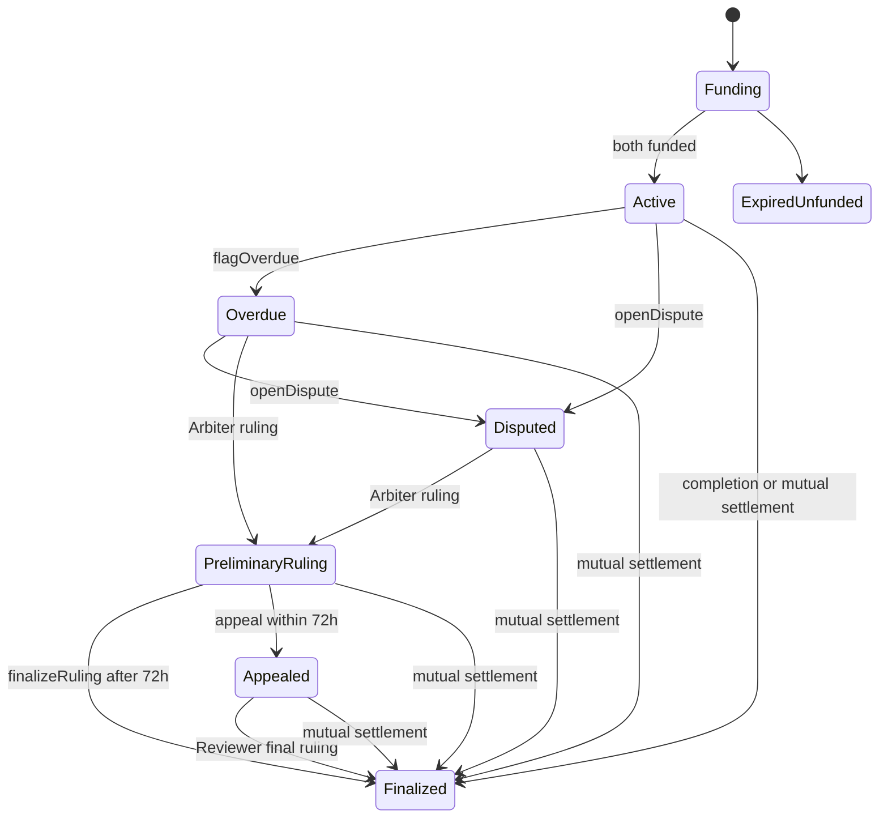

# Sure2PEscrowV2 design: rulings, one appeal, penalties, evidence anchors

## 1. Metadata

- Status: Approved by owner, deployed to Arc Testnet.
- Target chain: Arc Testnet (chain id 5042002). USDC only (ERC-20 view, 6 decimals). No mainnet.
- Toolchain: Solidity 0.8.28, Foundry, evm_version cancun, OpenZeppelin 5.6.1 (already pinned).
- Base: `contracts/Sure2PEscrow.sol` (V1). V1 stays deployed and unchanged. V2 is a new contract at a new address.
- Reviews: [ ] Design  [ ] Security  [ ] Ops (key custody for the four role addresses)

## 2. Action items (living)

- Owner supplies four addresses before deploy: owner, arbiter, appeal reviewer, penalty wallet. None may be the Arc Studio platform deployer wallet.
- Resolved: V2 deployed at `0xbac54f5f54516007b5db955ee45433920893d94a`. The app follows V2 only; V1 test escrows are no longer shown in the app (see section 14).

## 3. Goals and non-goals

Goals
- Give a locked escrow (Overdue or Disputed) a way out when the parties do not agree: an Arbiter issues a preliminary ruling, there is one 72 hour appeal, then the ruling is final.
- Let the ruling split the price, and penalize the at-fault party by up to 100% of that party's own deposit. Penalty USDC goes to one fixed penalty wallet.
- Anchor evidence submissions onchain (hash and timestamp only) so evidence cannot be backdated.
- Keep every V1 safety property: no sweep, no `claimTo`, funds only ever credited to buyer, seller or the penalty wallet, pull-based claims, mutual settlement still works.

Non-goals
- No automatic release on silence. If the Arbiter or Appeal Reviewer does nothing, the only exits are a mutual settlement or the owner replacing the role holder (chosen by you).
- No appeal bond or fee, no multi-arbiter voting, no on-chain evidence storage, no both-parties-at-fault penalties.
- No changes to V1 or the registry contract. No upgradeability.

## 4. Requirements

Functional
- F1. Arbiter may issue a preliminary ruling on an escrow in Overdue or Disputed.
- F2. Either party may appeal once, within 72 hours of the preliminary ruling.
- F3. If no appeal by the deadline, anyone may finalize the preliminary ruling.
- F4. Appeal Reviewer issues the final ruling on an appealed escrow. It is final.
- F5. A ruling is: price refund to buyer in [0, price], at-fault party (None, Buyer, Seller), penalty in [0, at-fault party's deposit], and a nonzero hash of the written reasoning.
- F6. Either party may anchor an evidence hash while the case is open.
- F7. Mutual settlement stays available until the escrow is Finalized, including during a ruling or appeal.

Security (each is a test assertion)
- S1. Sum of credits assigned at finalization equals price + buyer deposit + seller deposit exactly.
- S2. Penalty never exceeds the at-fault party's own deposit, and is 0 when fault is None.
- S3. Arbiter and Appeal Reviewer are never the same address, never a party of the escrow they rule on, and the final reviewer is never the address that issued the preliminary ruling.
- S4. At most one appeal per escrow. Only a party may appeal. Only before the deadline.
- S5. No ruling path moves funds to any address except buyer, seller or the immutable penalty wallet.
- S6. Owner has no ability to rule, move funds or change the penalty wallet.
- S7. Contract USDC balance >= `totalOutstanding` always.
- S8. Penalty wallet, arbiter, reviewer and owner cannot be a party when an escrow is created.

## 5. Terminology and actors

| Actor | On/off-chain | Trust | Can do |
|---|---|---|---|
| Buyer, Seller | on | untrusted | fund, declare/accept, open dispute, anchor evidence, appeal, mutual settle, claim |
| Arbiter | on (wallet) | semi-trusted | preliminary ruling only |
| Appeal Reviewer | on (wallet) | semi-trusted | final ruling on appealed escrows only |
| Owner | on (wallet, two-step) | semi-trusted | replace Arbiter and Appeal Reviewer. Nothing else |
| Penalty wallet | on | trusted recipient | receives penalties via `claim`. No other power. Immutable |
| Anyone | on | untrusted | flag overdue, finalize an unappealed ruling, expire unfunded |
| Server | off | untrusted for funds | stores evidence files and index. Never signs financial transactions |

Terms: preliminary ruling (Arbiter decision, appealable), appeal window (72 hours), final ruling (Reviewer decision or an unappealed preliminary ruling after the window), at-fault party (the party penalized).

## 6. Language and runtime

Solidity ^0.8.20 source, compiled with 0.8.28 (project standard, checked arithmetic). Cancun EVM. Base libraries: OpenZeppelin `EIP712`, `ReentrancyGuard`, `Ownable2Step`, `SafeERC20`, `SignatureChecker`, `SafeCast`. V2 copies V1 logic for everything not listed in section 10 so V1's reviewed behavior is preserved.

## 7. Transaction and execution model

Every function is atomic. External calls occur only in `fundBuyer`, `fundSeller` (USDC pull, balance delta checked) and `claim` (USDC push). All state, including credits and `totalOutstanding`, is written before the transfer (CEI) and those functions are `nonReentrant`. Ruling functions make no external call besides reading the registry on create.

## 8. Standards and interfaces

ERC-20 (USDC, 6 decimals). EIP-712 for agreements and settlements, domain name `Sure2PEscrow`, version `2` (new domain, so V1 signatures cannot replay on V2). ERC-1271 via `SignatureChecker` for contract-wallet parties. Registry interface unchanged (`isEligible`).

## 9. Architecture and flow of funds



| Step | Funds | Invariant |
|---|---|---|
| fund | buyer pays price + dep, seller pays dep into contract | balance delta equals amount, `totalOutstanding` grows by the same |
| ruling issued | none move | credits unchanged, state PreliminaryRuling |
| finalize or final ruling | credits assigned: buyer, seller, penalty wallet | sum equals price + both deposits exactly |
| claim | credit zeroed, then transfer | credit set to 0 before transfer, `totalOutstanding` reduced |

Resting invariant: contract USDC balance >= `totalOutstanding`; after all claims it holds only donated dust.

Dependencies: USDC, `Sure2PAccountRegistry` (unchanged, already deployed). Chain assumption: block timestamps are monotonic and roughly accurate (72 hour window tolerates seconds of drift).

## 10. Contract design

### Roles

| Role | Holder | Permissions | Why |
|---|---|---|---|
| owner | one address, `Ownable2Step` | `setArbiter`, `setAppealReviewer` | only way to replace a silent role holder |
| arbiter | one address | `issuePreliminaryRuling` | first-instance decision |
| appealReviewer | one address | `issueFinalRuling` | independent second look |
| penaltyWallet | immutable address | receives penalty credits | fixed so no admin can redirect penalties |

`setArbiter` and `setAppealReviewer` revert on zero address or when the new arbiter equals the current reviewer (and vice versa). `renounceOwnership` is disabled (reverts).

### Storage (additions to V1 layout)

- Immutable: `usdc`, `registry`, `penaltyWallet`.
- `address arbiter`, `address appealReviewer`.
- `mapping(uint256 => Ruling) _rulings` where

```
struct Ruling {
  address issuedBy;        // arbiter that issued the preliminary ruling
  uint64 issuedAt;
  uint64 appealDeadline;   // issuedAt + 72 hours
  uint256 buyerPriceRefund;
  uint256 penalty;
  Fault fault;             // None, Buyer, Seller
  bytes32 reasonHash;      // nonzero
  bool appealed;
  address appealedBy;
  uint64 appealedAt;
  bytes32 appealReasonHash;
}
```
- `enum Fault { None, Buyer, Seller }`. `State` enum order unchanged from V1 (PreliminaryRuling, Appealed already present).
- All V1 mappings and the `Escrow` struct are kept as is.

### Write functions (new)

| Function | Caller | State change | Events | Reverts |
|---|---|---|---|---|
| `issuePreliminaryRuling(id, buyerPriceRefund, fault, penalty, reasonHash)` | arbiter | state Overdue or Disputed becomes PreliminaryRuling, store ruling | `PreliminaryRulingIssued` | not arbiter, caller is a party, wrong state, refund > price, penalty > at-fault deposit, penalty > 0 with fault None, zero reasonHash |
| `appeal(id, reasonHash)` | buyer or seller | PreliminaryRuling becomes Appealed | `RulingAppealed` | not a party, wrong state, after `appealDeadline`, zero hash |
| `finalizeRuling(id)` | anyone | PreliminaryRuling becomes Finalized, credits assigned | `RulingFinalized`, `CreditAssigned` | wrong state, before `appealDeadline` |
| `issueFinalRuling(id, buyerPriceRefund, fault, penalty, reasonHash)` | appealReviewer | Appealed becomes Finalized, credits assigned | `FinalRulingIssued`, `CreditAssigned` | not reviewer, caller is a party, caller == `issuedBy`, wrong state, same bounds as above |
| `anchorEvidence(id, evidenceHash)` | buyer or seller | none (event only) | `EvidenceAnchored` | not a party, state not Overdue, Disputed, PreliminaryRuling or Appealed, zero hash |
| `setArbiter(address)` / `setAppealReviewer(address)` | owner | role holder replaced | `ArbiterChanged`, `AppealReviewerChanged` | zero address, equal to the other role |

Changed from V1: `createEscrow` additionally reverts if buyer or seller equals owner, arbiter, appealReviewer or penaltyWallet. `executeMutualSettlement` also accepts PreliminaryRuling and Appealed. `openDispute` unchanged.

Credit assignment (shared by both ruling paths):

```
buyerAmount  = buyerPriceRefund + buyerDeposit - (fault == Buyer  ? penalty : 0)
sellerAmount = (price - buyerPriceRefund) + sellerDeposit - (fault == Seller ? penalty : 0)
penaltyAmount = penalty
require(buyerAmount + sellerAmount + penaltyAmount == price + buyerDeposit + sellerDeposit)
state = Finalized; credit(buyer), credit(seller), credit(penaltyWallet) if > 0
```

`claim(id)` is unchanged and also serves the penalty wallet (per escrow).

Read functions: `getEscrow`, `getRuling`, `claimable`, `effectiveOverdue`, `overdueTrigger`, `appealOpen(id)`, `domainSeparator`, `hashAgreement`, `hashSettlement` (as V1).

### Events (new)

`PreliminaryRulingIssued(id indexed, issuedBy indexed, buyerPriceRefund, fault, penalty, reasonHash, appealDeadline)`, `RulingAppealed(id indexed, by indexed, reasonHash)`, `RulingFinalized(id indexed, byAppeal bool)`, `FinalRulingIssued(id indexed, issuedBy indexed, buyerPriceRefund, fault, penalty, reasonHash)`, `EvidenceAnchored(id indexed, by indexed, evidenceHash, at)`, `ArbiterChanged(old, new)`, `AppealReviewerChanged(old, new)`. All V1 events kept.

## 11. Deployment and initialization

Constructor: `(usdc, registry, penaltyWallet, owner, arbiter, appealReviewer)`. Reverts on zero addresses, on arbiter == appealReviewer, on penaltyWallet equal to the arbiter or the appeal reviewer (penaltyWallet MAY equal the owner: the owner has no ruling or fund power, so this is allowed and was chosen by you), and on USDC decimals != 6. Deterministic deployment through the project's existing `Create2Factory` script. Genesis keys: you provide all four addresses. The registry is reused (same address). Registry admin remains the platform deployer wallet today; moving it to your operator wallet is a separate registry action, recommended before real use.

## 12. Upgradeability

None (immutable). Migration story: contract switch. A bug means deploying V3 at a new address; open V2 escrows finish on V2.

## 13. Key management and signing

Agreement and settlement signatures stay EIP-712 with nonce, deadline, domain separator and chain id. Rulings are plain transactions from the role wallet (no off-chain signature), so there is nothing to replay. Recommended: owner, arbiter and appeal reviewer are three different wallets, ideally multisigs for anything beyond testnet.

## 14. App scope that rides with this contract (phase 1)

- Admin console `/admin`: signs in with the same phone code and wallet signature as every user, then access is granted only when the signed-in wallet equals the onchain arbiter or appeal reviewer, checked against the chain on each request. Shows cases in Overdue, Disputed, PreliminaryRuling, Appealed with agreement terms, timeline and evidence. Rulings are sent from the admin's own wallet.
- Evidence: parties upload files (size and type limits, sha256 recorded) while the case is open and during the appeal window. Visible only to the two parties and the admins. Optionally the party anchors the bundle hash onchain via `anchorEvidence`. Storage: local disk in dev, a durable object store on Vercel.
- Party UI: dispute view shows ruling, penalty, appeal countdown and an Appeal button, then claim.
- Indexer and ABI: handle the new events. The indexer and UI follow V2 only; the 3 V1 test escrows remain on the V1 contract and can be settled or claimed there directly.
- Deferred to a later phase: notifications, AI Copilot.

## 15. Security considerations

| Vulnerability | Applicable | Mitigation |
|---|---|---|
| Reentrancy | yes (`fundBuyer`, `fundSeller`, `claim`) | CEI plus `nonReentrant`. Ruling functions have no external calls |
| Access control | yes | arbiter, reviewer, owner, party checks listed per function. Conflict-of-interest checks (S3, S8) |
| Overflow | checked 0.8 | no `unchecked` blocks. Conservation asserted after every credit split |
| Unchecked external call | yes | `SafeERC20`, balance delta on pulls |
| Fee-on-transfer tokens | yes | token fixed to USDC, delta check kept |
| Signature replay | yes | EIP-712 version 2 domain, nonces, deadlines. Settlement nonce bumps |
| Front-running | low | an appeal vs finalize race at the deadline is resolved by timestamp: `appeal` must be at or before `appealDeadline`, `finalizeRuling` strictly after |
| Oracle, flash loan | no | no price feeds |
| DoS | yes | pull-over-push claims. No loops |
| Delegatecall, proxy | no | not upgradeable |
| Timestamp dependence | yes | 72 hour window, seconds of miner drift irrelevant |
| Approval persistence | yes | exact-amount approvals in the UI |
| Centralization | yes | Arbiter and Reviewer have bounded power: they can only choose a split and penalty inside the escrow's own funds. See section 16 |
| Role capture by a party | yes | party or role-holder collisions rejected at creation and at ruling |
| Evidence spam | yes | anchors are event-only, parties only, open cases only |
| Stuck funds on inactive role holder | yes (accepted) | owner can replace the role holder. Mutual settlement remains |

## 16. Trust model and threat analysis

| Key | Worst case if compromised or malicious | Mitigation | Detection |
|---|---|---|---|
| Arbiter | rules for one side on every locked escrow, with up to 100% penalty on the other side's deposit. Can never take funds outside buyer, seller or penalty wallet | one appeal by the harmed party to a different reviewer, only locked escrows are affected, owner can replace | `PreliminaryRulingIssued` alerts |
| Appeal Reviewer | final ruling in favor of one side on appealed escrows | distinct from arbiter by construction, owner can replace | `FinalRulingIssued` alerts |
| Owner | replaces Arbiter or Reviewer with an accomplice | cannot rule or move funds itself. Two-step ownership. Appeal window gives time to react before finalization | `ArbiterChanged`, `AppealReviewerChanged` |
| Penalty wallet | none beyond receiving penalties | immutable, never settable | `Claimed` by that address |

Colluding Arbiter plus Reviewer plus Owner can steal locked escrow funds. This is the accepted centralization of an arbitrated escrow and is why the doc recommends multisigs beyond testnet.

## 17. Emergency response

No pause and no rescue function by design: V1 had none and an admin able to freeze or sweep USDC would break the "no admin custody" promise. Response to a compromised role holder: owner replaces it (`setArbiter` or `setAppealReviewer`). Compromised owner: nothing can move funds, but role replacement is possible, so owner should be a multisig.

## 18. Failure scenarios

- Arbiter never rules: escrow stays locked. Owner replaces the arbiter, or the parties sign a mutual settlement.
- Reviewer never reviews an appeal: same, via owner replacement or mutual settlement.
- Owner replaces the arbiter mid-case: the new arbiter can rule on Overdue and Disputed cases. If the reviewer is later replaced by the old arbiter, `issueFinalRuling` still reverts for that address (S3).
- Penalty wallet cannot receive (it is a normal USDC credit claimed by that wallet): if USDC blocks it, only its own credit is stuck, buyer and seller claims are unaffected.
- Buyer or seller is a contract wallet that cannot claim: only that credit is stuck.
- Party appeals at the last second and Arbiter's ruling is unchanged: reviewer's decision is final, no second appeal.

## 19. Priorities and tradeoffs

| Decision | Tradeoff | Alternatives rejected |
|---|---|---|
| Two named role holders, owner replaces them | simple, but centralized and liveness depends on humans | timelock or multi-arbiter voting (more code and delay), automatic refund after N days (you chose none) |
| Reviewer may change the outcome in any direction, including worse for the appellant | strongest independent review, but appeal can backfire | restrict reviewer to the appellant's relief (hard to define fairly) |
| No appeal bond | no spam protection beyond one appeal per escrow | USDC bond (adds funds flows and refund rules) |
| Penalty wallet immutable | cannot fix a lost key | admin-changeable with timelock (you chose immutable) |
| Evidence offchain, hash anchored onchain | needs server availability for files, hashes always verifiable | IPFS pinning (extra dependency), full onchain data (cost) |
| Mutual settlement allowed during a ruling | parties can always agree out | block it during appeal (traps cooperative parties) |
| New contract, V1 untouched | two address migration | upgrade V1 (it has no proxy) |

## 20. Testing strategy

Foundry in `contracts/test/`: ruling happy paths for every fault and penalty bound (0, mid, 100%), conservation fuzz, state-machine reverts for every function and wrong state, role conflict tests (S3, S8), appeal boundary at the exact deadline second, owner replacement during a case, mutual settlement during PreliminaryRuling and Appealed, reentrancy token, and an invariant suite (credits plus claimed equals funded, balance >= outstanding, at most one appeal). V1's 185 tests stay. Static analysis with Slither, a two-auditor security review at the highest depth, and a fork rehearsal before any live deploy. Command: `forge test`.

## 21. Third-party libraries

OpenZeppelin Contracts 5.6.1 (already a dependency, widely reviewed): `EIP712`, `ReentrancyGuard`, `Ownable2Step`, `SafeERC20`, `SignatureChecker`, `SafeCast`. Nothing new.

## 22. Monitoring

Alert on every `PreliminaryRulingIssued`, `RulingAppealed`, `FinalRulingIssued`, `ArbiterChanged`, `AppealReviewerChanged` (all high severity). Warn when an escrow sits in Overdue, Disputed or Appealed for more than 7 days. Existing balance versus liability reconciliation continues.

## 23. Stakeholders

You (owner): approves roles, key custody and penalty wallet. Security review covers the contract. Whoever runs the Arbiter and Reviewer wallets reviews the console workflow.

## 24. Worked example

Price 100 USDC, deposits 25 each, escrow Disputed. Arbiter rules buyerPriceRefund 100, fault Seller, penalty 25 (100% of the seller deposit), reasonHash H. After 72 hours with no appeal anyone calls `finalizeRuling`: buyer is credited 100 + 25 = 125, seller 0 + 25 - 25 = 0, penalty wallet 25. Total 150 equals the escrow. Each claims with `claim(id)`. If the seller appeals within 72 hours, the reviewer (not the arbiter) decides and that decision is final.
