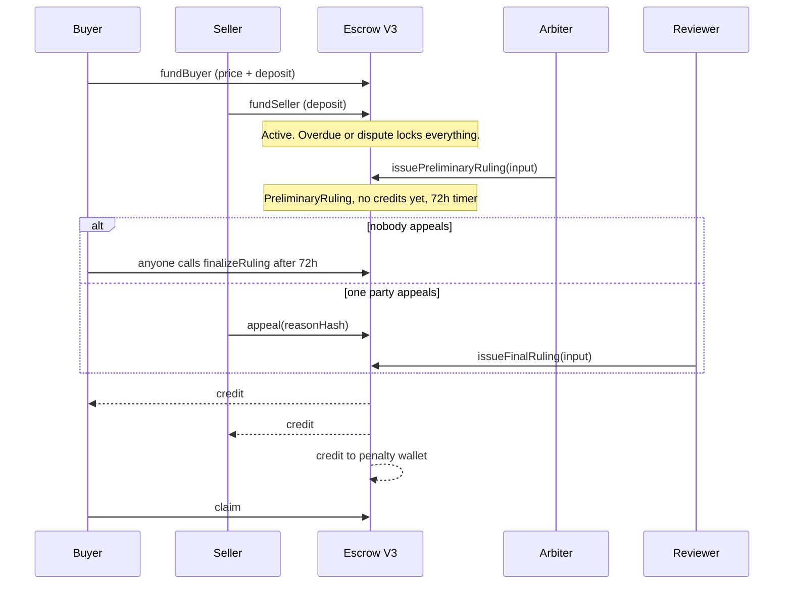

# Sure2PEscrowV3 design

## 1. Metadata

- Status: Draft, waiting for owner approval. Nothing is written or deployed yet.
- Target chain: Arc Testnet (chain id 5042002). USDC `0x3600000000000000000000000000000000000000`, 6 decimals as an ERC-20.
- Language and toolchain: Solidity ^0.8.20, compiled with 0.8.28 (Cancun), Foundry, OpenZeppelin 5.6.1. Same as V2.
- Source spec: the 10-part sure2p spec (sections 2.4, 2.5, 5, 7.2 F16 and F18, 9, 14).
- Relationship to V2: V3 is a new file and a new address. It is derived from `Sure2PEscrowV2.sol` and changes only the ruling model, role separation and fraud recording. Everything else is deliberately unchanged and not re-argued here (funding, handover, acceptance, overdue, dispute, mutual settlement, claim).
- Review tracker: [ ] Design (owner) [ ] Security (internal review at max depth after writing) [ ] Ops (cutover runbook, section 12) [ ] Compliance (N/A, testnet only) [ ] Independent audit (not scheduled, decision D06).

## 2. Action items

- Owner to approve this design before any code is written.
- Owner to decide whether the registry `SECURITY_ROLE` moves from the shared platform deployer wallet to a wallet the owner controls. Needed before any fraud ban can be executed. V3 does not change the registry.

## 3. Goals and non-goals

Goals
- Rulings can refund each party's deposit separately and mark each party at fault or fraudulent, exactly as spec 2.4 and F16 describe.
- Both deposits can be penalised in one ruling. A non-faulty party always gets its full deposit back.
- The ruling commits to the escrow's agreement hash, the reason and the frozen evidence list root.
- A confirmed fraud flag from a final ruling is readable onchain so the security admin can ban an account without trusting the server.
- Role separation per spec 9 and 14, with one deliberate exception (owner equals penalty wallet).

Non-goals
- No upgradeability. V3 is replaced, not upgraded.
- The contract never bans anyone. The registry stays a separate contract.
- No change to funding windows, deposit math (25%, rounded up), the 72-hour appeal window, mutual settlement or claim rules.
- No platform fee, no multi-token support, no cross-chain logic.
- No automatic release on silence. If the arbiter or reviewer never acts, funds stay locked until the owner replaces them or both parties sign a mutual settlement.

## 4. Requirements

Functional
- F1. `issuePreliminaryRuling` and `issueFinalRuling` take a `RulingInput` with: price refund to the buyer, buyer deposit refund, seller deposit refund, at-fault flag per party, fraud flag per party, reason hash, evidence root, and the escrow's agreement hash.
- F2. Payouts: buyer = price refund + buyer deposit refund; seller = (price − price refund) + seller deposit refund; penalty wallet = unrefunded part of both deposits.
- F3. Appeal: unchanged from V2. One shared round within 72 hours of the preliminary ruling. The final reviewer must differ from the preliminary issuer and must not be a party.
- F4. `previewRuling` returns the three payouts for a given input and reverts on any invalid input, so the console can show the exact split before signing.
- F5. After finalization, `outcomeOf(id)` returns the effective ruling (preliminary if nobody appealed, final if appealed) and `fraudConfirmed(id)` returns the two fraud flags only when the effective ruling is final.

Security (each is a testable assertion)
- S1. The three payouts always sum to price + buyer deposit + seller deposit. A violation reverts with `ConservationViolation`.
- S2. A party not flagged at fault always receives its full deposit.
- S3. A fraud flag without the same party's at-fault flag reverts.
- S4. No path pays any address other than buyer, seller or the immutable penalty wallet.
- S5. Preliminary rulings never create credits. Only finalization does.
- S6. A ruling signed for escrow A cannot be applied to escrow B (agreement hash check).
- S7. Arbiter, appeal reviewer and owner are three different addresses at all times. The penalty wallet differs from arbiter and reviewer. The penalty wallet may equal the owner (recorded exception).
- S8. Owner, arbiter, reviewer and penalty wallet can never be a buyer or seller of a new escrow, and arbiter or reviewer cannot rule on an escrow where they are a party.
- S9. Mutual settlement still pays penalty 0 and refunds both deposits in full, in every state before finalization.

## 5. Terminology and actors

| Actor | On/offchain | Trust | Can do |
| --- | --- | --- | --- |
| Buyer, Seller | Onchain wallets | Untrusted | Create, fund, declare, acknowledge, accept, dispute, appeal (once, shared), mutual settlement, claim |
| Arbiter | Onchain wallet, a person | Semi-trusted | Issue the preliminary ruling for Overdue or Disputed escrows. Cannot move funds outside the ruling bounds |
| Appeal reviewer | Onchain wallet, a person | Semi-trusted | Issue the final ruling after a valid appeal |
| Owner | Onchain wallet (a 2-of-3 Safe is possible, set up by the owner) | Trusted | Replace arbiter and reviewer, two-step ownership transfer. Cannot rule, cannot touch funds |
| Penalty wallet | Onchain wallet, immutable | Trusted recipient | Claims penalties like any other credit |
| Registry security role | Onchain, separate contract | Trusted | Bans or unbans wallets from creating new escrows. Not part of V3 |
| Anyone | | Untrusted | Flag overdue, expire unfunded, finalize an unappealed ruling after 72 hours |

Terms. Deposit: ceil(price / 4) per party. Credit: an amount assigned to an address and claimable only by that address. Effective ruling: the ruling that decided the escrow.

## 6. Language, execution model, standards

- Solidity 0.8.x for checked arithmetic. Any `unchecked` block must be justified; V3 plans none.
- All state changes in a call are atomic. External calls only happen in `claim` and the funding functions, after state updates, under `nonReentrant` (CEI).
- Standards: ERC-20 via SafeERC20, EIP-712 for agreement and settlement signatures with ERC-1271 support through OpenZeppelin `SignatureChecker`, `Ownable2Step`.
- Domain: name `Sure2PEscrow`, version `3`, so no signature from V2 can replay on V3.

## 7. Architecture and flow of funds



| Step | Who moves what | Invariant |
| --- | --- | --- |
| Fund | Buyer and seller pull-in exact amounts | Balance delta equals expected amount, else revert |
| Ruling (preliminary or final) | Nothing moves | `totalOutstanding` unchanged |
| Finalize | Credits assigned to buyer, seller, penalty wallet | Sum of the three equals price + both deposits (S1) |
| Claim | The credited address pulls its own credit | `totalOutstanding` decreases by exactly the credit |

Resting-state invariant: USDC balance of the contract >= `totalOutstanding`. After every escrow is claimed, `totalOutstanding` is 0 (any surplus is donations).

Dependencies: Arc USDC, the existing `Sure2PAccountRegistry` (reused, unchanged), OpenZeppelin.

## 8. Contract design

### 8.1 Roles

| Role | Holder at deploy | Permissions | Why |
| --- | --- | --- | --- |
| owner (Ownable2Step) | `0xEb8d90588D11B6798727Df71E482d7330aD7253e` | `setArbiter`, `setAppealReviewer`, `transferOwnership` (two-step). `renounceOwnership` reverts | Liveness: only a human can replace a silent role holder |
| arbiter | `0x3026f60aF3120bE269e5853A9aFd68e7D202fEB6` | Preliminary rulings | Spec 2.4 |
| appealReviewer | `0x835E29330e70ce7C6103f7E2243e045E575DA88E` | Final ruling | Spec 2.5 |
| penaltyWallet (immutable) | `0xEb8d90588D11B6798727Df71E482d7330aD7253e` | Receives penalty credits | Spec 2.4. Equal to owner by explicit owner choice |

Distinctness rules enforced in the constructor and in every setter and in ownership transfer: arbiter != reviewer, arbiter != owner, reviewer != owner, penaltyWallet != arbiter, penaltyWallet != reviewer. `penaltyWallet == owner` is the only allowed overlap.

### 8.2 Storage (delta from V2)

Unchanged: `Escrow` struct, `State` enum order, `credits`, `totalOutstanding`, `escrowCount`, agreement and nonce maps.

```solidity
struct RulingInput {
    bytes32 agreementHash;      // must equal the escrow's agreementHash
    uint256 buyerPriceRefund;   // 0..price
    uint256 buyerDepositRefund; // 0..buyerDeposit
    uint256 sellerDepositRefund;// 0..sellerDeposit
    bool buyerAtFault;
    bool sellerAtFault;
    bool buyerFraud;            // requires buyerAtFault
    bool sellerFraud;           // requires sellerAtFault
    bytes32 reasonHash;         // non-zero
    bytes32 evidenceRoot;       // non-zero, root of the frozen evidence list
}

struct Ruling {                 // preliminary ruling and appeal metadata
    address issuedBy; uint64 issuedAt; uint64 appealDeadline;
    RulingInput input;
    bool appealed; address appealedBy; uint64 appealedAt; bytes32 appealReasonHash;
}

struct Outcome {                // the effective ruling, written at finalization
    address decidedBy; uint64 decidedAt; bool byAppeal; RulingInput input;
}

mapping(uint256 => Ruling) private _rulings;
mapping(uint256 => Outcome) private _outcomes;
```

### 8.3 Validation rule (one internal function, used by preview and both ruling functions)

```text
require input.agreementHash == escrow.agreementHash
require reasonHash != 0 and evidenceRoot != 0
require buyerPriceRefund <= price
require buyerDepositRefund <= buyerDeposit and sellerDepositRefund <= sellerDeposit
if !buyerAtFault  -> require buyerDepositRefund == buyerDeposit   (S2)
if !sellerAtFault -> require sellerDepositRefund == sellerDeposit (S2)
if buyerFraud  -> require buyerAtFault                             (S3)
if sellerFraud -> require sellerAtFault
buyerGets   = buyerPriceRefund + buyerDepositRefund
sellerGets  = (price - buyerPriceRefund) + sellerDepositRefund
penaltyGets = (buyerDeposit - buyerDepositRefund) + (sellerDeposit - sellerDepositRefund)
require buyerGets + sellerGets + penaltyGets == price + buyerDeposit + sellerDeposit (S1)
```

### 8.4 Write functions that change (all others are identical to V2)

| Function | Caller | State change | Events | Reverts |
| --- | --- | --- | --- | --- |
| `issuePreliminaryRuling(id, RulingInput)` | arbiter, not a party | State Overdue or Disputed -> PreliminaryRuling. Stores ruling, sets `appealDeadline = now + 72h` | `PreliminaryRulingIssued` | Wrong state, caller not arbiter or is a party, invalid input |
| `appeal(id, reasonHash)` | buyer or seller | PreliminaryRuling -> Appealed, once | `RulingAppealed` | After deadline, already appealed, non-party, zero hash |
| `finalizeRuling(id)` | anyone | After `appealDeadline`, if not appealed: writes `_outcomes` from the preliminary input, assigns credits, state -> Finalized | `RulingFinalized(id, false)`, `CreditAssigned` x up to 3 | Before or at deadline, appealed, wrong state |
| `issueFinalRuling(id, RulingInput)` | reviewer, not the preliminary issuer, not a party | Appealed -> Finalized. Writes `_outcomes`, assigns credits | `FinalRulingIssued`, `RulingFinalized(id, true)`, `CreditAssigned` | Wrong state, caller rules, invalid input |
| `setArbiter`, `setAppealReviewer` | owner | Replace role holder, enforce distinctness | `ArbiterChanged`, `AppealReviewerChanged` | Zero, distinctness, equals penalty wallet or owner |
| `transferOwnership` (Ownable2Step) | owner | Pending owner set | OZ events | New owner equals arbiter or reviewer |

Credits with a zero amount are not assigned. `claim`, funding, mutual settlement and the rest are unchanged.

### 8.5 Read functions

`getRuling(id)`, `outcomeOf(id)`, `appealOpen(id)`, `previewRuling(id, RulingInput) -> (buyerGets, sellerGets, penaltyGets)`, `fraudConfirmed(id) -> (buyerFraud, sellerFraud)`. `fraudConfirmed` returns `(false, false)` unless the escrow is Finalized through a ruling (not mutual settlement) and `_outcomes[id]` exists.

### 8.6 Events (monitoring contract)

| Event | Params | Emitted when |
| --- | --- | --- |
| `PreliminaryRulingIssued` | id, issuedBy, buyerPriceRefund, buyerDepositRefund, sellerDepositRefund, flags (4 bools), reasonHash, evidenceRoot, appealDeadline | Preliminary ruling stored |
| `RulingAppealed` | id, by, reasonHash | Appeal filed |
| `FinalRulingIssued` | id, issuedBy, same ruling fields | Reviewer's final ruling |
| `RulingFinalized` | id, byAppeal | Escrow reaches Finalized by ruling |
| `CreditAssigned`, `Claimed`, `EvidenceAnchored` | as V2 | as V2 |

## 9. Worked example (spec 2.4)

Price 100, deposits 25 each (total 150). Arbiter rules: buyer price refund 20, buyer deposit refund 25 (no fault), seller deposit refund 15 (seller at fault).

| Party | Amount | Calculation |
| --- | --- | --- |
| Buyer | 45 | 20 + 25 |
| Seller | 95 | (100 − 20) + 15 |
| Penalty wallet | 10 | 0 + (25 − 15) |
| Total | 150 | 45 + 95 + 10 |

## 10. Deployment, migration and keys

- Deploy with `forge` artifacts through the platform deploy tool (Mode 1). Constructor: usdc, registry (existing `0xfa6a19d4597a55f1f64003fb28fba199f8bafacd`), penaltyWallet, owner, arbiter, appealReviewer, with the four addresses in 8.1. The deploy tool's own wallet is not a role holder.
- No upgrade path (non-upgradeable). Migration story: contract switch. V2 (`0xbac54f5f...94a`) has 0 escrows and 0 outstanding funds (read from the chain), so nothing is stranded. The app switches by changing `VITE_SURE2P_ESCROW_ADDRESS`, the deploy tx and the regenerated ABI; the indexer resets its cursor for a new contract address automatically. V1 escrows (3, about 1.5 USDC) remain claimable directly on V1.
- Keys: owner key is cold and used only to replace roles. Arbiter and reviewer keys are hot (they sign rulings through the console). EIP-712 domain version 3.
- Runbook: deploy, read back `owner/arbiter/appealReviewer/penaltyWallet`, update app config, redeploy the app, verify `/api/trust`.

## 11. Security considerations

| Vulnerability | Applicable | Mitigation |
| --- | --- | --- |
| Reentrancy | Yes, at `claim` and funding | CEI plus `nonReentrant` on every state-changing function |
| Access control | Yes | Role checks on every privileged function; distinctness invariants S7 and S8 tested |
| Integer overflow | Checked arithmetic | No `unchecked` blocks planned |
| Unchecked external call | Yes | SafeERC20 and balance-delta checks (kept from V2) |
| Fee-on-transfer tokens | Only if the token were not USDC | Constructor pins the token and checks 6 decimals; funding asserts exact balance delta |
| Signature replay | Agreement and settlement signatures | EIP-712 domain version 3, nonces, deadlines, chain id, verifying contract |
| Ruling replay across escrows | Yes | Agreement hash inside `RulingInput` is checked (S6) |
| Front-running | Appeal at the deadline | Appeal allowed up to and including the deadline, finalize only strictly after it |
| Oracle or flash loan | No | N/A, no price input |
| Denial of service | Yes | No loops over user input, pull-based claims |
| Delegatecall or proxy | No | Not upgradeable |
| Timestamp dependence | 72-hour and 24-hour windows | Tolerance of seconds is irrelevant at these durations; not used for randomness |
| Approval persistence | Yes | Users approve exact amounts; the contract never holds a standing approval |
| Centralization | Yes | Owner can only swap role holders; arbiter and reviewer bounded by validation; section 12 |
| Issuer blocklist of the contract on USDC | Yes | Cannot be mitigated in code; documented as an accepted asset-level risk and shown on the trust page |
| Griefing by a faulty or silent arbiter | Yes | No automatic release by design (owner's choice); owner replacement or mutual settlement is the exit |

## 12. Trust model and threat analysis

| Actor | Worst case if the key is compromised | Mitigation | Detection |
| --- | --- | --- | --- |
| Arbiter | Issues a harsh ruling, up to 100% of both deposits to the penalty wallet and all price to one side, on cases in Overdue or Disputed | 72-hour appeal to a different reviewer; owner can replace; mutual settlement still available | `PreliminaryRulingIssued` alerts; every ruling carries a reason and evidence root |
| Appeal reviewer | Same power but only after an appeal, and final | Distinct from the arbiter; owner can replace before they act | `FinalRulingIssued` alerts |
| Owner | Replace arbiter and reviewer with colluding addresses (cannot move funds directly) | Two-step ownership; recommended 2-of-3 Safe; replacement is visible onchain | `ArbiterChanged`, `AppealReviewerChanged` alerts |
| Penalty wallet | None beyond claiming its own credits | Immutable address | `Claimed` events |
| Arbiter plus reviewer colluding through the owner | Can redirect up to the penalty on any disputed case | Documented, same owner holds the penalty wallet (accepted exception); independent audit recommended before real funds | Trust page shows roles and the exception |

Conflict of interest, stated plainly: the owner also controls the penalty wallet, so the party that can replace the judges benefits from penalties. This is a recorded exception and is shown on the public trust page and risk disclosure.

## 13. Emergency response

- There is no pause and no rescue function (neither was requested, and neither exists in V2). Rationale: a pause lets one key freeze user funds, which the spec forbids.
- Incident playbook: if the arbiter or reviewer is compromised or silent, the owner calls the setter. If the owner key is compromised, funds remain safe from direct theft, and the damage is limited to replacing role holders. Users always have mutual settlement.
- Deprecation: deploy a successor and re-point the app; existing escrows finish on the old contract.

## 14. Failure scenarios

- Ruling transaction reverts on invalid input: no state change, the escrow stays Overdue or Disputed.
- Nobody calls `finalizeRuling`: funds stay locked; anyone, including a party, can call it after 72 hours.
- Owner replaces the arbiter after a preliminary ruling: the stored ruling keeps its `issuedBy`; the appeal reviewer must still differ from it.
- A party is later made arbiter or reviewer: ruling on that escrow reverts (S8).
- Recipient is blocklisted by USDC: only that recipient's claim reverts; other credits are unaffected (pull payments).
- USDC itself blocklists the escrow: all claims fail. Accepted and documented.

## 15. Priorities and tradeoffs

| Decision | Tradeoff | Rationale and rejected alternatives |
| --- | --- | --- |
| New contract instead of patching V2 | App cutover and a new address | V2 is immutable by design. Rejected: a proxy upgrade, which adds an upgrade authority the spec does not want |
| Record fraud flags onchain, ban in the registry separately | Two transactions, and a human must send the ban | Keeps the registry role separate (spec 4: security admin enforces the ban). Rejected: giving the escrow the security role, which would let any ruling auto-ban and would widen a compromised arbiter's power |
| Both parties may be penalised in one ruling | More validation code | Spec 2.4 formula requires it. Rejected: single at-fault party (V2), which cannot express the spec's example |
| Agreement hash inside the ruling input | One more field | Cheap replay defense. Rejected: relying only on the escrow id |
| Store the effective ruling in `_outcomes` | Extra storage per case | Lets the trust page and ban flow read the final decision without parsing logs. Rejected: events only |
| Owner equals penalty wallet | Conflicts with spec 9 distinctness | Owner's explicit decision, recorded in `docs/DECISIONS.md` and shown on the trust page |
| No automatic fallback if judges are silent | Funds can stay locked | Owner's explicit decision |
| Contract size | V2 is 20.1 KB of a 24.6 KB limit | V3 adds a struct and a view. Plan: keep the validation in one internal function; if the size passes 24,000 bytes, drop `previewRuling` first |

## 16. Testing strategy

- Foundry unit tests for every row in section 8.4 and every revert in 8.3, plus the worked example in section 9 and the V2 test base reused for funding, handover, overdue, dispute and mutual settlement.
- Fuzz: conservation (S1) over random prices and refunds; non-fault full refund (S2); fraud implies fault (S3); penalty wallet gets exactly the unrefunded deposits.
- Invariants: balance >= `totalOutstanding`; at most one appeal per escrow; no credit before finalization; arbiter, reviewer and owner distinct after any sequence of owner calls; credits plus claimed equal funded for finalized escrows.
- Static analysis with Slither, and a security review of the new ruling code at maximum depth.
- Branch coverage target 100% on the ruling and role code.
- Command: `forge test` (full suite, V1 and V2 tests stay green).
- Gate: no deploy until tests, review and static analysis are clean.

## 17. Third-party libraries

| Library | Version | Existing dependency | Why |
| --- | --- | --- | --- |
| OpenZeppelin Contracts | 5.6.1 | Yes | Ownable2Step, ReentrancyGuard, EIP712, SafeERC20, SignatureChecker, SafeCast. Audited |
| forge-std | repo `lib/` | Yes (test only) | Foundry testing |

## 18. Monitoring and alerting

| Event or metric | Threshold | Severity | Action |
| --- | --- | --- | --- |
| `PreliminaryRulingIssued` | any | Info | Notify both parties, start the appeal timer display |
| `FinalRulingIssued` with a fraud flag | any | High | Prompt the security admin to review and ban |
| `ArbiterChanged`, `AppealReviewerChanged` | any | High | Verify it was intended |
| Balance < `totalOutstanding` | any | Critical | Stop the app, investigate (the trust page already shows this) |
| Escrow in PreliminaryRuling past `appealDeadline` | > 24 h | Low | Remind someone to call `finalizeRuling` |

## 19. Stakeholders

Owner (design and role holder decisions), security reviewer (ruling and role code), operations (cutover and ban process), the arbiter and reviewer (they sign through the admin console).

## 20. App changes this contract forces (listed for sequencing, not designed here)

New ABI, new event shapes in the indexer projection, new `rulings` columns (added by `ALTER TABLE` so the existing database keeps working), the admin console form (per-party refund, fault and fraud flags with an onchain `previewRuling` check), the party and trust views, and the ban flow. These come after the contract is deployed and verified.
